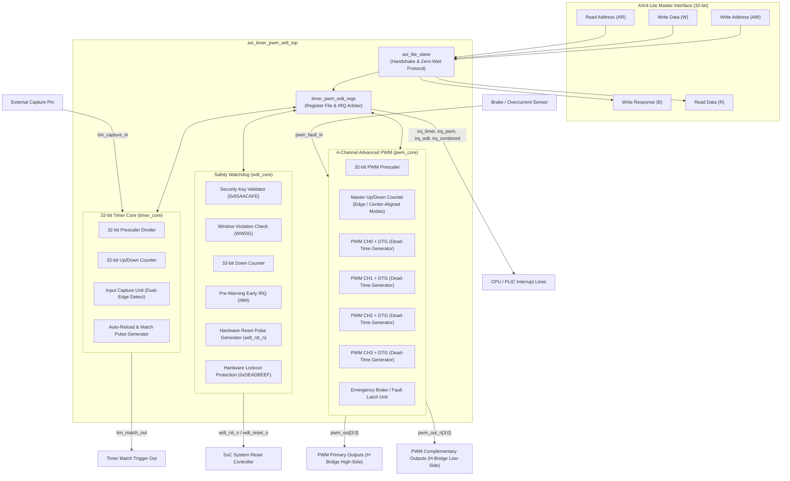

# AXI4-Lite Integrated Timer + 4-Channel PWM + Watchdog (WDT) IP

[](#)
[](#)
[-success)](#)
[](#)
[](#)
[](LICENSE)

**AXI_TIMER_PWM_WDT** is an integrated **AXI4-Lite Peripheral IP Core** designed for embedded systems, FPGA and ASIC SoC designs (such as AMD / Xilinx MicroBlaze, RISC-V, and Arm processors), and industrial motor/power control.

This IP integrates:
1. **1x High-Precision 32-bit General-Purpose Timer** (Timer / Input Capture / Periodic Auto-Reload)
2. **4-Channel Advanced PWM Generator** (Center/Edge-Aligned + Dead-Time Insertion + Emergency Brake/Fault Protection)
3. **Industrial Dual-Stage Safety Watchdog** (Windowed Watchdog / WWDG + Early-Warning IRQ + Hardware Reset Pulse + Lockout Protection)

---

## 1. System Hardware Architecture



---

## 2. Key Functional Features

### A. AXI4-Lite Slave Interface (`axi_lite_slave.sv`)
- Compliant with standard ARM AXI4-Lite 32-bit specifications.
- Independent read/write state machines supporting back-to-back zero-wait state access.
- Byte-strobe (`wstrb`) write support and unaligned access protection.

### B. 32-bit General-Purpose Timer (`timer_core.sv`)
- **32-bit Prescaler**: Provides $1 \sim 2^{32}$ clock prescaling division.
- **Counting Modes**:
  - **Auto-Reload (Periodic)**: Generates continuous periodic interrupts and match pulses.
  - **One-Shot**: Halts automatically and asserts an interrupt upon reaching target count.
  - **Up / Down Counting**: Configurable counting direction.
- **Input Capture**: Built-in 2-stage synchronizer; supports Rising edge, Falling edge, or Both-edge latching of timer count values with instant interrupt generation.
- **Match Output Pulse**: Asserts single-cycle pulse `tim_match_out` on overflow/match for hardware triggering of ADCs or DMA.

### C. 4-Channel Advanced PWM Generator (`pwm_core.sv`, `pwm_channel.sv`, `pwm_deadtime.sv`)
- **4 Independent Channels**: Each channel features independent 32-bit compare threshold (`CMP0` ~ `CMP3`), channel enable, and polarity inversion control.
- **Alignment Modes**:
  - **Edge-Aligned Mode**: Sawtooth up-counting.
  - **Center-Aligned (Symmetrical) Mode**: Triangular up-down counting; minimizes harmonic distortion and EMI, ideal for multi-phase motor drives.
- **Dead-Time Insertion (DTG)**:
  - Generates complementary output pairs (`pwm_out[x]` and `pwm_out_n[x]`).
  - Programmable dead-time duration (0 ~ 65535 cycles); forces both high-side and low-side switches low during switching transitions to eliminate half-bridge shoot-through.
- **Emergency Brake / Fault Protection**:
  - Hardware response within 1 clock cycle upon assertion of `pwm_fault_in`, forcing all outputs to a safe level (All-Low / All-High) and asserting an interrupt.

### D. Industrial Dual-Stage Safety Watchdog (`wdt_core.sv`)
- **Security Key Mechanism**: Requires writing `0x55AACAFE` to `WDT_KEY` to reload/service watchdog, preventing rogue software routines from accidentally refreshing the counter.
- **Windowed Watchdog Mode (WWDG)**: Defines valid feeding window. Service attempts made "too early" (before window open) or "too late" (after timeout) trigger immediate fault action.
- **Two-Stage Action**:
  - **Stage 1 (Pre-Warning Early IRQ / NMI)**: Fires an early-warning interrupt when counter reaches warning threshold, providing CPU time to log crash diagnostics.
  - **Stage 2 (Hardware System Reset)**: Drives dedicated hardware reset pulses (`wdt_rst_n` active-low and `wdt_reset_o` active-high) of configurable duration (default 16 cycles).
- **Hardware Lockout Protection**:
  - Writing `0xDEADBEEF` irreversibly locks all critical WDT settings until a cold hardware reset occurs.

---

## 3. Register Map

All registers are 32-bit word aligned:

| Offset | Register Name | Access | Reset Value | Description |
|:---|:---|:---:|:---:|:---|
| `0x00` | `REG_IP_ID_VER` | RO | `0x5450_5701` | IP Core Identification ("TPW" v1.0) |
| `0x04` | `REG_GLOBAL_CTRL` | RW | `0x0000_0001` | Bit 0: Global Enable, Bit 1: Soft Reset |
| `0x08` | `REG_INTR_RAW` | RO | `0x0000_0000` | Raw Interrupt Status Flags |
| `0x0C` | `REG_INTR_EN` | RW | `0x0000_0000` | Interrupt Enable Mask |
| `0x10` | `REG_INTR_MASKED` | RO | `0x0000_0000` | Masked Interrupt Status (`RAW & EN`) |
| `0x14` | `REG_INTR_CLR` | W1C | `0x0000_0000` | Interrupt Clear Register (Write-1-to-Clear) |
| **0x20 - 0x34** | **--- Timer Subsystem ---** | | | |
| `0x20` | `REG_TIM_CTRL` | RW | `0x0000_0000` | Bit 0: EN, Bit 1: Mode (0=Periodic, 1=One-Shot), Bit 2: Dir (0=Up, 1=Down), Bit 3: CapEn, Bits [5:4]: CapEdge (00=Rise, 01=Fall, 10=Both), Bit 8: Soft Trigger |
| `0x24` | `REG_TIM_PRESCALER` | RW | `0x0000_0000` | 32-bit Timer Prescaler Divisor (`div = Prescaler + 1`) |
| `0x28` | `REG_TIM_COUNTER` | RW | `0x0000_0000` | 32-bit Real-time Timer Counter Value |
| `0x2C` | `REG_TIM_AUTORELOAD` | RW | `0x0000_FFFF` | 32-bit Auto-Reload Period (ARR) |
| `0x30` | `REG_TIM_CAPTURE` | RO | `0x0000_0000` | 32-bit Captured Timestamp Latch |
| `0x34` | `REG_TIM_STATUS` | RO | `0x0000_0000` | Bit 0: Running, Bit 1: Capture Flag, Bit 2: Overflow Flag |
| **0x40 - 0x6C** | **--- PWM Subsystem ---** | | | |
| `0x40` | `REG_PWM_CTRL` | RW | `0x0000_0000` | Bit 0: Master EN, Bit 1: Center-Aligned Mode, Bit 2: Brake EN, Bit 3: Brake Pol, Bit 4: Safe Level, Bits [11:8]: Complementary Output EN for CH0..3 |
| `0x44` | `REG_PWM_PRESCALER` | RW | `0x0000_0000` | 32-bit PWM Prescaler Divisor |
| `0x48` | `REG_PWM_PERIOD` | RW | `0x0000_03E8` | 32-bit PWM Period Length (ARR, default 1000) |
| `0x4C` | `REG_PWM_COUNTER` | RO | `0x0000_0000` | 32-bit Real-time PWM Master Counter |
| `0x50` | `REG_PWM_CH0_CMP` | RW | `0x0000_0000` | Channel 0 Duty Compare Value |
| `0x54` | `REG_PWM_CH1_CMP` | RW | `0x0000_0000` | Channel 1 Duty Compare Value |
| `0x58` | `REG_PWM_CH2_CMP` | RW | `0x0000_0000` | Channel 2 Duty Compare Value |
| `0x5C` | `REG_PWM_CH3_CMP` | RW | `0x0000_0000` | Channel 3 Duty Compare Value |
| `0x60` | `REG_PWM_CH_CFG` | RW | `0x0000_0000` | Bits [3:0]: CH0..3 Enable, Bits [7:4]: CH0..3 Polarity (0=Active High) |
| `0x64` | `REG_PWM_DEADTIME` | RW | `0x0000_0000` | Bits [15:0]: Dead-time insertion duration in clock cycles |
| `0x68` | `REG_PWM_FAULT_CFG` | RW | `0x0000_0000` | Bit 0: Fault Clear (Write 1 to clear latched fault) |
| `0x6C` | `REG_PWM_STATUS` | RO | `0x0000_0000` | Bit 0: Fault Active, Bits [4:1]: CH0..3 Match, Bit 5: Period Match |
| **0x80 - 0x9C** | **--- Watchdog Subsystem ---** | | | |
| `0x80` | `REG_WDT_CTRL` | RW | `0x0000_0004` | Bit 0: WDT EN, Bit 1: Window EN, Bit 2: Reset EN (default 1), Bit 3: Pre-Warn IRQ EN |
| `0x84` | `REG_WDT_KEY` | WO | - | Write `0x55AACAFE` (Feed/Reload), Write `0xDEADBEEF` (Hardware Lock) |
| `0x88` | `REG_WDT_TIMEOUT_VAL`| RW | `0x0000_FFFF` | 32-bit Watchdog Timeout Countdown Initial Value |
| `0x8C` | `REG_WDT_WINDOW_VAL` | RW | `0x0000_7FFF` | 32-bit Window Upper Threshold (feeding above this triggers violation) |
| `0x90` | `REG_WDT_WARN_VAL` | RW | `0x0000_1000` | 32-bit Pre-Warning Early Interrupt Threshold |
| `0x94` | `REG_WDT_COUNTER` | RO | `0x0000_FFFF` | 32-bit Current Watchdog Countdown Value |
| `0x98` | `REG_WDT_STATUS` | RO | `0x0000_0000` | Bit 0: Locked, Bit 1: Timeout Flag, Bit 2: Window Violation Flag, Bit 3: Pre-Warn Flag |
| `0x9C` | `REG_WDT_RST_WIDTH` | RW | `0x0000_0010` | 8-bit System Reset Output Pulse Width (default 16 cycles) |

---

## 4. Interrupt Allocation Map

Bit allocations in `INTR_RAW`, `INTR_EN`, `INTR_MASKED`, and `INTR_CLR`:

| Bit | Interrupt Source | Trigger Condition | Subsystem |
|:---:|:---|:---|:---:|
| `Bit 0` | `INTR_TIM_OVF` | Timer counter overflow / match reload | Timer |
| `Bit 1` | `INTR_TIM_CAP` | External `tim_capture_in` edge event | Timer |
| `Bit 2` | `INTR_PWM_PERIOD` | PWM master counter cycle end / period restart | PWM |
| `Bit 3` | `INTR_PWM_CH0` | PWM Channel 0 compare match | PWM |
| `Bit 4` | `INTR_PWM_CH1` | PWM Channel 1 compare match | PWM |
| `Bit 5` | `INTR_PWM_CH2` | PWM Channel 2 compare match | PWM |
| `Bit 6` | `INTR_PWM_CH3` | PWM Channel 3 compare match | PWM |
| `Bit 7` | `INTR_PWM_FAULT` | Emergency brake / fault sensor triggered | PWM |
| `Bit 8` | `INTR_WDT_WARN` | Watchdog counter reached pre-warning threshold | Watchdog |
| `Bit 9` | `INTR_WDT_WIN_FAIL` | Window violation (counter refreshed prematurely) | Watchdog |
| `Bit 10`| `INTR_WDT_TIMEOUT` | Watchdog countdown reached 0 (Timeout) | Watchdog |

---

## 5. External Pinout

```text
                       +-------------------------+
                       |  axi_timer_pwm_wdt_top  |
    s_axi_awaddr [31:0]|===>                     |
    s_axi_wdata  [31:0]|===>                     |===> pwm_out   [3:0] (Primary PWM)
    s_axi_araddr [31:0]|===>                     |===> pwm_out_n [3:0] (Dead-Time Complementary)
    s_axi_rdata  [31:0]|<===                     |
                       |                         |---> tim_match_out
    tim_capture_in     |--->                     |---> wdt_reset_o (Active-High Reset)
    pwm_fault_in       |--->                     |---> wdt_rst_n   (Active-Low Reset)
                       |                         |
                       |                         |---> irq_timer
                       |                         |---> irq_pwm
                       |                         |---> irq_wdt
                       |                         |---> irq_combined
                       +-------------------------+
```

---

## 6. Verification Suite

Accompanied by a complete Verilator C++ testbench covering **13 test suites with 30 assertions**:

```bash
cd AXI_TIMER_PWM_WDT
make test
```

### Verification Test Summary
- **Test Suite 1**: IP Identification & Register R/W defaults
- **Test Suite 2**: Timer Prescaler & Auto-Reload Periodic Mode
- **Test Suite 3**: Timer One-Shot & Down-Counting Mode
- **Test Suite 4**: Timer Input Capture Event Latching
- **Test Suite 5**: 4-Channel PWM Independent Duty Cycles
- **Test Suite 6**: PWM Center-Aligned Symmetrical Mode
- **Test Suite 7**: PWM Complementary Outputs & Dead-Time Insertion (Shoot-Through Protection)
- **Test Suite 8**: PWM Emergency Brake & Hardware Fault Shutdown
- **Test Suite 9**: Watchdog Key Security & Feed Mechanism
- **Test Suite 10**: Watchdog Timeout & Hardware Reset Pulse Generation
- **Test Suite 11**: Watchdog Window Violation Detection (WWDG)
- **Test Suite 12**: Watchdog Hardware Lockout Protection
- **Test Suite 13**: Interrupt Matrix & Masking

---

## 7. Software C Driver & Quickstart

Complete C driver headers and firmware examples are provided in [`sw/timer_pwm_wdt.h`](sw/timer_pwm_wdt.h) and [`sw/example_main.c`](sw/example_main.c).

### Quickstart Example:
```c
#include "timer_pwm_wdt.h"
#define TPW_BASE 0x20000000UL

void app_init(void) {
    // 1. Initialize 1ms periodic timer (100MHz / (99 + 1) = 1MHz, 1000 ticks = 1ms)
    tpw_timer_init(TPW_BASE, 99, 1000, true, false);
    tpw_timer_start(TPW_BASE);

    // 2. Initialize 4-channel center-aligned 50kHz PWM with 400ns dead-time
    tpw_pwm_init(TPW_BASE, 0, 1000, true, 20);
    tpw_pwm_set_channel(TPW_BASE, 0, 500, true, false, true); // CH0: 50% complementary
    tpw_pwm_set_channel(TPW_BASE, 1, 250, true, false, true); // CH1: 25% complementary

    // 3. Initialize windowed watchdog (1.0s timeout, 0.4s window, 100ms pre-warning)
    tpw_wdt_init(TPW_BASE, 50000000, 30000000, 5000000, true, true, true);
    tpw_wdt_lock(TPW_BASE); // Lock configuration against tamper
}

// Service watchdog in main control loop
void loop(void) {
    tpw_wdt_feed(TPW_BASE);
}
```

---

## 8. Directory Structure

```text
AXI_TIMER_PWM_WDT/
├── component.xml                     # AMD / Xilinx Vivado IP definition
├── xgui/
│   └── axi_timer_pwm_wdt_top_v1_0.tcl # Vivado GUI parameter customization script
├── Makefile                          # Build, Lint, Test, and Waveform targets
├── README.md                         # Documentation
├── rtl/
│   ├── pkg/
│   │   └── timer_pwm_wdt_pkg.sv      # Constants, byte offsets, keys, bit definitions
│   ├── axi/
│   │   └── axi_lite_slave.sv         # AXI4-Lite slave bus controller
│   ├── core/
│   │   ├── timer_core.sv             # 32-bit timer / input capture / prescaler
│   │   ├── pwm_deadtime.sv           # Dead-time generator (non-overlapping deadband)
│   │   ├── pwm_channel.sv            # Channel comparator, polarity, and deadtime integration
│   │   ├── pwm_core.sv               # 4-channel PWM generator (center/edge-aligned + brake)
│   │   ├── wdt_core.sv               # Windowed watchdog (key unlock, pre-warn, hardware reset)
│   │   └── timer_pwm_wdt_regs.sv     # Register file & interrupt matrix
│   └── top/
│       └── axi_timer_pwm_wdt_top.sv  # Top-level integration module
├── tb/
│   ├── tb_timer_pwm_wdt.sv           # SystemVerilog testbench top
│   └── tb_timer_pwm_wdt.cpp          # C++ Verilator 30-assertion automated test suite
└── sw/
    ├── timer_pwm_wdt.h               # C/C++ driver header & register structures
    └── example_main.c                # Firmware example application
```
