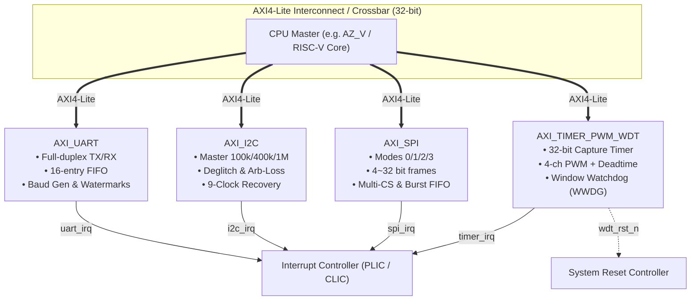

# AXI-Peripheral

[](#)
[](#)
[](#)
[](#)
[](LICENSE)

A high-performance, modular, and silicon-proven open-source **AXI4-Lite Peripheral IP Suite** designed for RISC-V SoC architectures (such as [AZ_V_SoC](https://github.com/zenbear2/AZ_V_SoC)), embedded microcontrollers, and FPGA/ASIC platforms.

All IP cores strictly adhere to the standard 32-bit AXI4-Lite bus interface, incorporate dedicated asynchronous interrupt signals, and come with comprehensive, self-checking Verilator C++ testbench suites.

---

## 1. System Architecture



---

## 2. Peripheral IP Catalog

### 1. `AXI_UART`
- **Interface**: AXI4-Lite Slave (32-bit)
- **Features**:
  - Full-duplex asynchronous serial transmitter and receiver
  - 16-deep independent synchronous FIFOs for TX and RX
  - Configurable 16-bit fractional baud rate division generator
  - Programmable TX empty / RX watermark threshold interrupts
  - Overrun error detection and frame status tracking
  - Built-in internal digital loopback self-test mode

### 2. `AXI_I2C`
- **Interface**: AXI4-Lite Slave (32-bit)
- **Features**:
  - Multi-speed I2C Master: Standard (100 kHz), Fast (400 kHz), Fast-mode Plus (1 MHz)
  - Configurable digital deglitch filtering on SCL and SDA lines
  - Slave clock stretching support with programmable timeout detection & auto-abort
  - Multi-master bus arbitration loss detection
  - Repeated START condition support and 10-bit addressing protocol framing
  - Hardware 9-clock pulse bus stuck recovery mechanism
  - Independent TX and RX FIFOs with programmable watermark interrupt triggers

### 3. `AXI_SPI`
- **Interface**: AXI4-Lite Slave (32-bit)
- **Features**:
  - Universal SPI Master supporting Motorola Modes 0, 1, 2, and 3 (CPOL / CPHA)
  - Configurable transfer word length from 4 to 32 bits dynamically
  - MSB-first and LSB-first bit ordering selection
  - Up to 4 hardware chip-select lines (`spi_ss_n[3:0]`) with auto or manual software toggling
  - High-throughput burst transmission with 16-depth dual FIFO pipeline
  - Fully verified against standard SPI Flash memory (W25Qxx protocol)

### 4. `AXI_TIMER_PWM_WDT` (alias `AXI_TIMER`)
- **Interface**: AXI4-Lite Slave (32-bit)
- **Features**:
  - **General-Purpose Timer**: 32-bit up/down counter, prescaler (1~65536), periodic auto-reload, one-shot mode, and input capture event edge latching
  - **4-Channel Advanced PWM**: Center-aligned (dual-slope) and edge-aligned modulation, complementary outputs with configurable dead-time insertion, and hardware emergency brake / fault protection shutdown
  - **Dual-Safety Watchdog (WWDG)**: Windowed watchdog protection, early-warning interrupt before reset, hardware system reset pulse output (`wdt_rst_n`), and tamper-proof register write lockout
  - **Software Support**: Includes clean C driver headers and usage examples in `sw/`

---

## 3. Recommended SoC Memory Map

| Peripheral Name | Default Base Address | Address Range | Primary Interrupt Line |
|:---|:---:|:---:|:---:|
| **AXI_UART** | `0x2000_0000` | 4 KB (`0x2000_0000 - 0x2000_0FFF`) | `uart_irq` |
| **AXI_I2C** | `0x2000_1000` | 4 KB (`0x2000_1000 - 0x2000_1FFF`) | `i2c_irq` |
| **AXI_SPI** | `0x2000_2000` | 4 KB (`0x2000_2000 - 0x2000_2FFF`) | `spi_irq` |
| **AXI_TIMER_PWM_WDT** | `0x2000_3000` | 4 KB (`0x2000_3000 - 0x2000_3FFF`) | `timer_irq` / `wdt_rst_n` |

---

## 4. Repository Structure

```text
AXI-Peripheral/
├── Makefile                 # Top-level unified build & verification orchestrator
├── README.md                # Top-level documentation
├── LICENSE                  # Apache 2.0 License
├── .gitignore               # Build artifact exclusion rules
├── AXI_I2C/                 # I2C Master IP
│   ├── rtl/                 # SystemVerilog RTL (AXI slave, FSM, filter, FIFO)
│   ├── tb/                  # Verilator C++ testbench & slave model
│   ├── Makefile             # Standalone test runner
│   └── README.md            # Detailed register specification
├── AXI_SPI/                 # SPI Master IP
│   ├── rtl/                 # SystemVerilog RTL (AXI slave, SPI core, timing)
│   ├── tb/                  # Verilator C++ testbench & Flash slave model
│   ├── Makefile             # Standalone test runner
│   └── README.md            # Detailed register specification
├── AXI_TIMER_PWM_WDT/       # Timer, PWM & Watchdog Subsystem
│   ├── rtl/                 # SystemVerilog RTL (Timer, PWM, WDT, deadtime)
│   ├── tb/                  # Verilator C++ testbench
│   ├── sw/                  # C driver headers and example code
│   ├── Makefile             # Standalone test runner
│   └── README.md            # Detailed register specification
├── AXI_TIMER -> AXI_TIMER_PWM_WDT  # Symlink alias for convenience
└── AXI_UART/                # Full-Duplex UART IP
    ├── rtl/                 # SystemVerilog RTL (AXI slave, baud gen, FIFO)
    ├── tb/                  # Verilator C++ testbench and modular tests
    ├── Makefile             # Standalone test runner
    └── README.md            # Detailed register specification
```

---

## 5. Quickstart & Verification

### Prerequisites
- **Verilator**: 4.106 or newer (`sudo apt install verilator`)
- **GCC / G++**: C++11 or newer (`build-essential`)
- **Make** & **Python 3**

### Run All Test Suites
Run the automated testbenches for all 4 peripherals in one step:
```bash
make test-all
```

### Run Verilator Lint Checks
Run static lint analysis across all SystemVerilog RTL modules:
```bash
make lint-all
```

### Individual Peripheral Tests
```bash
make test-uart    # Test AXI_UART
make test-i2c     # Test AXI_I2C
make test-spi     # Test AXI_SPI
make test-timer   # Test AXI_TIMER_PWM_WDT
```

### Package for AMD / Xilinx Vivado IP Catalog / Block Design
Package all 4 peripheral cores (`AXI_UART`, `AXI_I2C`, `AXI_SPI`, `AXI_TIMER_PWM_WDT`) with automatic AXI4-Lite bus interface inference:
```bash
# Using Makefile
make package-all

# Or directly with Vivado
vivado -mode batch -source package_all_ips.tcl -nolog -nojournal
```
Once packaged, add the `AXI-Peripheral` folder to Vivado's **IP Repository** (`Settings -> IP -> Repository`), and all cores will appear in Vivado's IP Catalog ready for drag-and-drop into Block Designs.

### Clean Artifacts
```bash
make clean
```

---

## 6. License

This project is licensed under the [Apache 2.0 License](LICENSE).
